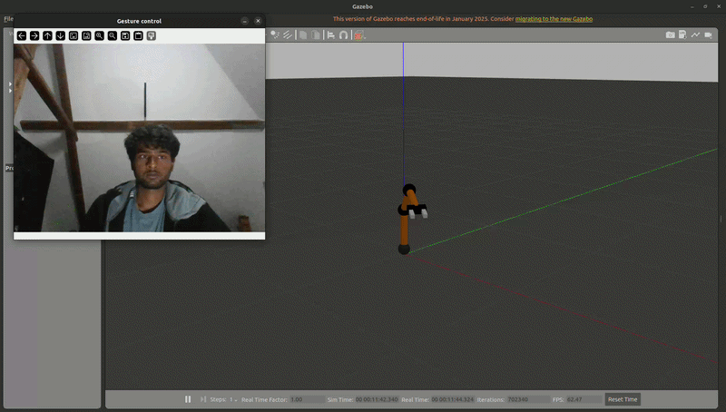

# Gesture-Controlled Robot Arm (ROS 2 + Gazebo)

A 3-axis robot arm with a two-finger gripper, simulated in Gazebo and controlled in real time by hand gestures through a webcam. Hand tracking uses MediaPipe, and the arm is driven through ros2_control.



## How it works

```
Webcam ──> MediaPipe hand tracking ──> gesture_control node ──> ros2_control controllers ──> Arm in Gazebo
           (21 hand landmarks)         (hand → joint angles,     (arm_controller,
                                        inverse kinematics)       gripper_controller)
```

1. **MediaPipe** detects the hand in each webcam frame and returns 21 landmarks.
2. The **`gesture_control` node** turns the hand's position, distance from the camera, and openness into a target for the arm. For reach and height, it uses **inverse kinematics** to calculate the joint angles that place the gripper at that target.
3. The node publishes joint trajectories to two **ros2_control** controllers: one for the arm, one for the gripper.
4. The controllers move the arm's joints in **Gazebo**.

## Controls

| Hand movement | Arm motion |
|---|---|
| Move left / right | Base rotates left / right |
| Move up / down | Gripper moves up / down |
| Move toward / away from the camera | Gripper reaches forward / back |
| Open / close your hand | Gripper opens / closes |

## Robot

- 3 revolute joints: base rotation plus two bending joints
- 2 prismatic gripper fingers
- Modeled in **Xacro**, with collision and inertia properties for physics simulation
- Separate trajectory controllers for the arm and the gripper

## Tech stack

ROS 2 Humble · Gazebo Classic 11 · ros2_control · Xacro / URDF · Python · MediaPipe · OpenCV

## Requirements

- Ubuntu 22.04
- ROS 2 Humble
- Gazebo Classic 11
- A webcam

ROS 2 packages:

```bash
sudo apt install ros-humble-gazebo-ros-pkgs ros-humble-ros2-control \
  ros-humble-ros2-controllers ros-humble-gazebo-ros2-control ros-humble-xacro
```

Python packages:

```bash
pip install mediapipe==0.10.14 opencv-python "numpy<2"
```

`mediapipe==0.10.14` is pinned because newer versions removed the `solutions` API used here, and `numpy<2` keeps compatibility with ROS 2 Humble.

## Build

```bash
cd ~/ros2_ws/src
git clone https://github.com/Aditya3003/gesture-arm.git
cd ~/ros2_ws
colcon build --symlink-install --packages-select arm_description arm_control
source install/setup.bash
```

## Run

**Terminal 1: start the simulation**

```bash
ros2 launch arm_description gazebo.launch.py
```

Wait until the controllers report "Configured and activated."

**Terminal 2: start gesture control**

```bash
source ~/ros2_ws/install/setup.bash
ros2 run arm_control gesture
```

A camera window opens. Hold up one hand and move it to control the arm. Press Ctrl+C in the terminal to stop.

There is also a demo node that runs a fixed motion sequence without the webcam:

```bash
ros2 run arm_control demo
```

### Troubleshooting Gazebo startup

If Gazebo hangs on startup or the robot fails to spawn:

```bash
sudo killall -9 gazebo gzserver gzclient   # clear leftover Gazebo processes
export GAZEBO_MODEL_DATABASE_URI=""         # stop Gazebo waiting for the online model database
```

## Calibration

The mapping from hand to arm depends on your camera and seating position. Adjust the values at the top of `arm_control/arm_control/gesture_control.py`. No rebuild is needed.

- `SIZE_MIN`, `SIZE_MAX`: the hand size shown in the camera window when your hand is far from / close to the camera. This sets the reach range.
- `X_MIN`, `X_MAX`, `Y_MIN`, `Y_MAX`: your comfortable range of hand movement in the image (0 to 1).
- `SMOOTHING`: lower values are smoother but react more slowly.

## Project structure

```
gesture-arm/
├── arm_description/          # Robot model and simulation
│   ├── config/
│   │   └── arm_controllers.yaml
│   ├── launch/
│   │   └── gazebo.launch.py
│   └── urdf/
│       └── arm.urdf.xacro
└── arm_control/              # Control nodes
    └── arm_control/
        ├── gesture_control.py
        └── demo.py
```

## Versions

- **v1.0:** first working gesture control, with hand position mapped directly to joint angles
- **v2.0:** reach controlled by hand distance from the camera using inverse kinematics, calibrated ranges, and a visual update

## Notes

I also experimented with picking up objects in Gazebo. Grasping in Gazebo Classic is unreliable with position-controlled joints, since the simulation repositions the joints directly instead of driving them through physics, so objects slip out of the gripper. Pick and place was left out of this version.

## Author

Sai Krishna Aditya Kambhampati
